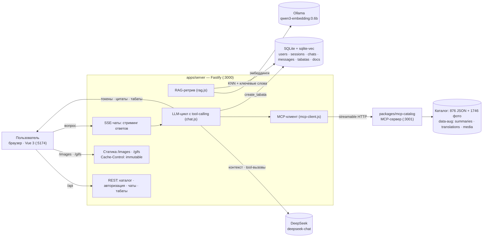

# gPower

**Каталог из 876 упражнений, ИИ-ассистент поддержки и табата-таймер.**


gPower — локальный мини-сервис вокруг каталога упражнений. В нём сочетаются каталог с фильтрами и двуязычным поиском (RU/EN), универсальный ИИ-ассистент с цитатами-карточками и RAG по данным каталога, подключение каталога через MCP и табата-таймер, тренировку для которого умеет подобрать тот же ассистент.

Проект — монорепо на npm workspaces: `apps/web` (Vue 3), `apps/server` (Fastify + RAG + LLM), `packages/catalog-core` (данные и поиск), `packages/mcp-catalog` (MCP-сервер). Всё работает локально; внешние зависимости — Ollama (эмбеддинги) и DeepSeek (LLM).

## Возможности

- **Каталог упражнений** — 876 упражнений с изображениями, русскими названиями и техникой (английские данные сохранены) и метаданными: мышцы, снаряжение, уровень, усилие, тип, категория.
- **Двуязычный поиск и фильтры** — поиск понимает русский и английский («грудь», «жим на грудь», «bench press»), результаты ранжируются по релевантности; значения фильтров подписаны по-русски.
- **Карточка упражнения** — фото с автосменой каждые 1с (кнопка ▶/⏸, ручной перебор по клику), GIF-анимация техники с обтеканием текстом (224 упражнения сопоставлены с внешним датасетом, © Gym visual), RU-название и пошаговая техника.
- **Ассистент** — личные чаты под аккаунтом, стриминг ответов по SSE, многострочное поле ввода; отвечает на любые вопросы, для фитнеса опирается на каталог.
- **Цитаты-карточки** — когда ассистент советует упражнения, к ответу прикладываются карточки с превью и ссылками на материалы.
- **Табата-таймер** — вкладка «Табата»: конструктор (поиск + фильтры, автоподгрузка списка, модальные карточки упражнений) и плеер (фазы подготовка/работа/отдых, крупный таймер, SVG-заглушка «отдыхающий человек», звук, Wake Lock, кнопка «Следующее», grayscale-заморозка на паузе).
- **Создание табаты через ассистента** — попросите «сделай табату для ребёнка»: ассистент задаст уточняющие вопросы (длительность, сложность, снаряжение, фокус), подберёт упражнения каталога, сохранит тренировку и покажет карточку с кнопкой «Открыть в таймере».
- **Анонимная «Помощь»** — чат с ассистентом без входа плюс FAQ-аккордеон; история живёт в браузере.
- **Простая авторизация** — логин и пароль (scrypt-хеши), HttpOnly cookie-сессии.
- **Деградация** — без Ollama ассистент отвечает без RAG, без MCP — без инструментов, без ключа LLM — понятная ошибка.

## Архитектура



## Как работает ассистент

### RAG — поиск по документации

Ассистент не отвечает «из головы»: перед генерацией он находит релевантную документацию.

1. **Документы.** Индекс — 2628 документов: 876 упражнений (название и техника, включая русский перевод) и 1752 сгенерированных описания (RU + EN по 876).
2. **Эмбеддинги.** `qwen3-embedding:0.6b` через Ollama — 1024-мерные векторы.
3. **Гибридный поиск.** KNN по векторам (`sqlite-vec`) + ключевой поиск по тексту; результаты ранжируются по объединённой оценке.
4. **Контекст.** Топ-6 документов попадают в системный промпт.
5. **Пополнение базы знаний.** `npm run summaries` генерирует RU/EN-описания, `npm run translations` — русские названия и технику; всё складывается в `data-aug/` (версионируется и ревьюится через диффы), затем `npm run index` пересобирает индекс.

### MCP — доступ к данным каталога

Каталог подключён к ассистенту как отдельный MCP-сервер (`packages/mcp-catalog`, streamable HTTP, порт 3001):

| Инструмент | Что делает |
|---|---|
| `search_exercises` | поиск и фильтрация: текст, мышцы, снаряжение, уровень, категория, лимит |
| `get_exercise` | полное описание одного упражнения (техника, мышцы, картинки) |
| `get_filters` | допустимые значения фильтров с русскими подписями |

Бэкенд чата подключается к MCP-серверу как **MCP-клиент**, получает инструменты и превращает их в tool-calling модели. Ассистент сам решает, когда вызвать инструмент; результаты возвращаются в модель, а найденные упражнения становятся **цитатами-карточками** прямо в ответе. MCP-сервер самодостаточен — его можно подключить к любому MCP-клиенту.

### Табата через ассистента

В личных чатах в набор инструментов добавляется локальный `create_tabata` (не часть MCP; выполняется на сервере чата с `user_id` сессии):

1. Пользователь просит собрать табату.
2. Ассистент **обязательно** задаёт уточняющие вопросы одним сообщением: длительность, сложность, снаряжение, целевые мышцы.
3. По ответам подбирает упражнения через `search_exercises` (классические интервалы 20/10 × 8, подготовка 10с).
4. Вызывает `create_tabata`, сохранённая тренировка приходит в чат SSE-событием `tabata` — с карточкой и кнопкой «Открыть в таймере».

Tool-цикл — до 8 шагов; если все шаги заняли вызовы инструментов, добавляется финальная генерация без инструментов, чтобы ответ никогда не оставался пустым.

### Контекст пользователя

- **История диалога** — до 10 последних сообщений в каждом запросе.
- **Личные чаты** — привязаны к аккаунту, сохраняются в SQLite.
- **Анонимная «Помощь»** — контекст хранится в браузере на время сессии.

## Примеры диалогов

**Вопрос о продукте:**

```text
Пользователь: Почему не работает авторизация?

Ассистент: Причин может быть несколько. Давайте пройдёмся по шагам —
1. Проверьте логин и пароль (регистр, лишние пробелы); если не уверены — зарегистрируйтесь заново.
2. Включены ли cookie: авторизация хранится в cookie/сессии…
3. Убедитесь, что сервер запущен: npm run dev → http://localhost:5174.
4. F12 → Network: 401 — неверные данные, ошибка соединения — сервер недоступен.
```

**Подбор упражнений** (с цитатами-карточками):

```text
Пользователь: Подбери 2 упражнения на спину с гантелями и кратко объясни технику

Ассистент: Вот два упражнения из каталога — оба уровня «Новичок», тянущие…
1. "Bent Over Two-Dumbbell Row" (тяга двумя гантелями в наклоне) — …
2. "One-Arm Dumbbell Row" (тяга одной гантелью в наклоне с опорой) — …

        [карточки упражнений с превью и ссылками]
```

**Табата:**

```text
Пользователь: для ребенка, создай табату

Ассистент: Уточни, пожалуйста, одним сообщением:
1. Желаемая длительность всей тренировки?
2. Уровень подготовки ребёнка — новичок, средний или продвинутый?
3. Какое снаряжение доступно?
4. На что сделать акцент — кардио, пресс, ноги, спина?

Пользователь: 10 минут, новичок, только вес тела, кардио

Ассистент: Готово — сохранил табату из 4 упражнений (подготовка 10с, 20/10, 8 раундов).
Открыть можно на вкладке «Табата».

        [карточка табаты → «Открыть в таймере»]
```

## Быстрый старт

**Требования:** Node.js 22+, [Ollama](https://ollama.com) с моделью `qwen3-embedding:0.6b`, API-ключ DeepSeek.

```bash
npm install
cp .env.example .env          # Windows: copy .env.example .env — впишите DEEPSEEK_API_KEY
ollama pull qwen3-embedding:0.6b
npm run index                 # сборка RAG-индекса (~18 минут, один раз; Ollama должна работать)
npm run dev                   # web :5174 · api :3000 · mcp :3001
```

Откройте http://localhost:5174 — вкладки «Упражнения», «Ассистент» (после входа), «Табата» и «Помощь».

RU/EN-описания и переводы упражнений уже лежат в `data-aug/`, поэтому генерация (`npm run summaries`, `npm run translations`) нужна только при обновлении каталога.

### GIF-анимации (опционально)

GIF-демонстрации живут во втором внешнем датасете, который в git не хранится. Без него всё работает — просто у упражнений `gifUrl: null`. Чтобы включить анимации, склонируйте датасет рядом с `free-exercise-db/`:

```bash
git clone https://github.com/Cesarfc206/exercises-dataset cesar-exercises-dataset
npm run media-map -- --write    # пересобрать маппинг data-aug/media (идемпотентно)
```

Медиа © Gym visual, распространяется с разрешения правообладателя (см. лицензии ниже).

## Скрипты

| Команда | Что делает |
|---|---|
| `npm run dev` | web + api + mcp одновременно (concurrently) |
| `npm run dev:api` / `dev:web` / `dev:mcp` | запуск по отдельности |
| `npm run index` | пересборка RAG-индекса (эмбеддинги через Ollama) |
| `npm run summaries` | генерация RU/EN-описаний упражнений (DeepSeek) |
| `npm run translations` | генерация RU-названий и техники упражнений (DeepSeek) |
| `npm run media-map` | пересборка маппинга GIF-датасета (`-- --write` для записи) |
| `npm run build` | продакшн-сборка web |

## Стек

| Слой | Технологии |
|---|---|
| Web | Vue 3, Vue Router, Vite, Tailwind CSS, WebAudio, Wake Lock API |
| API | Node.js, Fastify, Server-Sent Events, `@fastify/static` (immutable-кеш статики) |
| Данные | SQLite (`node:sqlite`), `sqlite-vec` |
| RAG | Ollama (`qwen3-embedding:0.6b`), гибридный поиск |
| LLM | DeepSeek (`deepseek-chat`), tool-calling, стриминг |
| Интеграция | MCP (`@modelcontextprotocol/sdk`), streamable HTTP |
| Каталог | free-exercise-db — 876 упражнений, The Unlicense |

## Структура проекта

```
gPower/
├── apps/
│   ├── server/           # Fastify: каталог, авторизация, чаты, табаты, RAG, MCP-клиент
│   │   ├── src/          # index, config, db, auth, rag, chat, tabata, mcp-client, routes*
│   │   └── scripts/      # build-index, generate-summaries, generate-translations, build-media-map
│   └── web/              # Vue 3: каталог, «Ассистент», «Табата», «Помощь», вход
│       └── src/          # views/, components/, api.js, tabata-player.js, image-rotator.js
├── packages/
│   ├── catalog-core/     # данные каталога, RU-словарь, поиск, фильтры, чтение резюме
│   └── mcp-catalog/      # MCP-сервер каталога (streamable HTTP)
├── data-aug/             # сгенерированные данные: summaries · translations · media (версионируются)
├── docs/                 # спецификация, контракты, ADR и SDD-процесс
├── data/                 # SQLite-база и RAG-индекс (gitignored)
├── free-exercise-db/     # внешний клон датасета (gitignored)
├── cesar-exercises-dataset/  # внешний клон GIF-датасета (gitignored)
├── AGENTS.md             # входной документ для LLM-агентов
└── .env                  # ключи и настройки (gitignored)
```

## Документация

Источник истины по продукту и системе — `docs/`:

| Документ | О чём |
|---|---|
| [`docs/SPEC.md`](docs/SPEC.md) | продукт, сценарии и функциональные требования (FR-1…FR-13) |
| [`docs/architecture.md`](docs/architecture.md) | компоненты, потоки, границы пакетов |
| [`docs/api.md`](docs/api.md) | REST-эндпоинты, коды, SSE-события |
| [`docs/data.md`](docs/data.md) | SQLite, датасеты, `data-aug`, RAG-индекс |
| [`docs/mcp.md`](docs/mcp.md) | MCP-сервер: инструменты, схемы, тестирование |
| [`docs/pitfalls.md`](docs/pitfalls.md) | грабли среды и реализации, «почему так написано» |
| [`docs/adr/`](docs/adr) | архитектурные решения (0001…0008) |
| [`docs/sdd/`](docs/sdd) | как вести разработку: спецификация → план → задачи |
| [`AGENTS.md`](AGENTS.md) | вход для LLM-агентов: инварианты и индекс документации |

## Источники данных и лицензии

- **Упражнения** — [free-exercise-db](https://github.com/yuhonas/free-exercise-db): 876 упражнений с изображениями, лицензия The Unlicense (public domain). Клон подключается как внешний репозиторий и не изменяется — все доработки данных живут в `data-aug/`, поэтому датасет обновляется через `git pull` без конфликтов.
- **GIF-анимации** — внешний датасет `cesar-exercises-dataset` (upstream `hasaneyldrm/exercises-dataset`): метаданные — MIT, медиа — **© Gym visual**, распространяется с разрешения правообладателя. Условия: сохранять подпись `© Gym visual — https://gymvisual.com/`, использовать только в исходном разрешении 180×180, не заявлять прав на медиа. Решение о принятии риска — ADR-0008.
