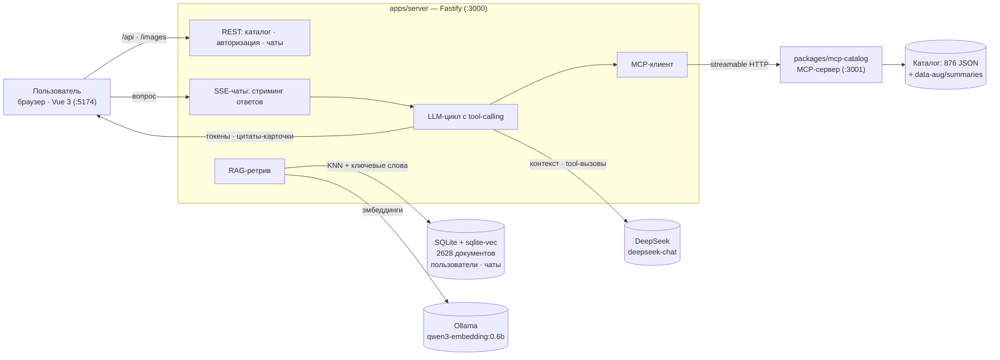

# gPower

**Каталог из 876 упражнений с ИИ-ассистентом поддержки пользователей.**

gPower — мини-сервис, в котором сочетаются каталог упражнений с фильтрами и двуязычным поиском, универсальный чат-ассистент и RAG-поиск по документации, подключённой через MCP. Ассистент вежливо отвечает на любые вопросы: о продукте, об упражнениях и обо всём остальном.

## Возможности

- **Каталог упражнений** — 876 упражнений с изображениями, техникой выполнения и метаданными (мышцы, снаряжение, уровень, усилие, тип, категория).
- **Двуязычный поиск и фильтры** — поиск понимает русский и английский («грудь», «жим на грудь», «bench press»), результаты ранжируются по релевантности; значения фильтров подписаны по-русски.
- **Вкладка «Помощь»** — чат с ассистентом без входа плюс FAQ-аккордеон; история диалога живёт в браузере.
- **Вкладка «Ассистент»** — личные чаты под аккаунтом, история сохраняется в базе.
- **Цитаты-карточки** — когда ассистент советует упражнения, к ответу прикладываются карточки с превью и ссылками на материалы.
- **Простая авторизация** — логин и пароль (scrypt-хеши), HttpOnly cookie-сессии.

## Архитектура



## Как работает поддержка пользователей

### RAG — поиск по документации

Ассистент не отвечает «из головы»: перед генерацией ответа он находит релевантную документацию.

1. **Документы.** Индекс — 2628 документов: 876 упражнений (название, техника, мышцы, снаряжение) и 1752 сгенерированных описания (RU + EN по 876).
2. **Эмбеддинги.** `qwen3-embedding:0.6b` через Ollama — 1024-мерные векторы.
3. **Гибридный поиск.** KNN по векторам (sqlite-vec) + ключевой поиск по тексту; результаты ранжируются по объединённой оценке.
4. **Контекст.** Топ-6 документов попадают в системный промпт — ассистент видит факты каталога до того, как начнёт отвечать.
5. **Пополнение базы знаний.** `npm run summaries` генерирует RU/EN-описания для каждого упражнения и складывает их в `data-aug/summaries/` (версионируется и ревьюится через диффы); `npm run index` пересобирает индекс. Так ассистент получает не только исходную документацию, но и живые «статьи» о каждом упражнении.

### MCP — доступ к данным каталога

Каталог подключён к ассистенту как отдельный MCP-сервер (`packages/mcp-catalog`, streamable HTTP, порт 3001):

| Инструмент | Что делает |
|---|---|
| `search_exercises` | поиск и фильтрация: текст, мышцы, снаряжение, уровень, категория, лимит |
| `get_exercise` | полное описание одного упражнения (техника, мышцы, картинки) |
| `get_filters` | допустимые значения фильтров с русскими подписями |

Как это работает в чате:

1. Бэкенд чата подключается к MCP-серверу как **MCP-клиент**, получает список инструментов и превращает их в tool-calling модели.
2. Ассистент **сам решает**, когда данных из RAG недостаточно, и вызывает инструменты — например, проверить наличие упражнения в каталоге или уточнить технику.
3. Результаты вызовов возвращаются в модель, а найденные упражнения становятся **цитатами** — карточками с превью прямо в ответе.
4. MCP-сервер самодостаточен: его можно подключить к любому MCP-клиенту и получить тот же доступ к каталогу.

Так реализован «мостик» между данными и интерфейсом: модель работает с каталогом как с набором инструментов, а пользователь сразу видит превью материалов, на которые ссылается ассистент.

### Контекст пользователя

- **История диалога** — до 10 последних сообщений передаётся в каждый запрос: ассистент помнит, о чём разговор, и уточняющие вопросы работают.
- **Личные чаты** — в «Ассистенте» диалоги привязаны к аккаунту и сохраняются в SQLite; следующий заход продолжает разговор с места остановки.
- **Анонимная «Помощь»** — без входа: контекст хранится в браузере на время сессии, вход нужен только для постоянной истории.
- **FAQ** — частые вопросы (регистрация, вход, каталог, отличие вкладок) раскрываются прямо на странице «Помощь» без обращения к модели.

## Примеры диалогов

**Вопрос о продукте:**

```text
Пользователь: Почему не работает авторизация?

Ассистент: Причин может быть несколько. Давайте пройдёмся по шагам —
чаще всего помогает что-то из этого:
1. Проверьте логин и пароль — включая регистр букв и лишние пробелы.
   Если не уверены в пароле — зарегистрируйтесь заново с другим логином.
2. Включены ли cookie в браузере: авторизация хранится в cookie/сессии…
3. Убедитесь, что сервер запущен: npm run dev → http://localhost:5174…
4. Откройте консоль браузера (F12 → Network): 401 — неверные данные,
   ошибка соединения — сервер не отвечает…
```

**Вопрос по существу каталога** (с цитатами-карточками):

```text
Пользователь: Подбери 2 упражнения на спину с гантелями и кратко
объясни технику

Ассистент: Вот два упражнения из каталога — оба уровня «Новичок»,
многосуставные, тянущие, основная нагрузка — середина спины…

1. "Bent Over Two-Dumbbell Row" (тяга двумя гантелями в наклоне) — …
2. "One-Arm Dumbbell Row" (тяга одной гантелью в наклоне с опорой) — …

        [карточки упражнений с превью и ссылками]
```

## Быстрый старт

**Требования:** Node.js 22+, [Ollama](https://ollama.com) с моделью `qwen3-embedding:0.6b`, API-ключ DeepSeek.

```bash
npm install
cp .env.example .env          # Windows: copy .env.example .env — впишите DEEPSEEK_API_KEY
ollama pull qwen3-embedding:0.6b
npm run index                 # сборка RAG-индекса (~18 минут, один раз; Ollama должна работать)
npm run dev                   # web :5174 · api :3000 · mcp :3001
```

Откройте http://localhost:5174 — вкладки «Упражнения», «Ассистент» (после входа) и «Помощь».

RU/EN-описания упражнений уже лежат в `data-aug/summaries/`, поэтому генерация (`npm run summaries`) нужна только при обновлении каталога.

## Скрипты

| Команда | Что делает |
|---|---|
| `npm run dev` | web + api + mcp одновременно (concurrently) |
| `npm run dev:api` / `dev:web` / `dev:mcp` | запуск по отдельности |
| `npm run index` | пересборка RAG-индекса (эмбеддинги через Ollama) |
| `npm run summaries` | генерация RU/EN-описаний упражнений (DeepSeek) |
| `npm run build` | продакшн-сборка web |

## Стек

| Слой | Технологии |
|---|---|
| Web | Vue 3, Vue Router, Vite, Tailwind CSS |
| API | Node.js, Fastify, Server-Sent Events |
| Данные | SQLite (node:sqlite), sqlite-vec |
| RAG | Ollama (`qwen3-embedding:0.6b`), гибридный поиск |
| LLM | DeepSeek (`deepseek-chat`), tool-calling, стриминг |
| Интеграция | MCP (`@modelcontextprotocol/sdk`), streamable HTTP |
| Каталог | free-exercise-db — 876 упражнений, public domain |

## Структура проекта

```
gPower/
├── apps/
│   ├── server/           # Fastify: каталог, авторизация, чаты, RAG, MCP-клиент
│   │   ├── src/
│   │   └── scripts/      # build-index, generate-summaries
│   └── web/              # Vue 3: каталог, «Ассистент», «Помощь», вход
├── packages/
│   ├── catalog-core/     # данные каталога, RU-словарь, поиск, фильтры
│   └── mcp-catalog/      # MCP-сервер каталога (streamable HTTP)
├── data-aug/summaries/   # 876 сгенерированных RU/EN-описаний
├── data/                 # SQLite-база и RAG-индекс (gitignored)
├── free-exercise-db/     # внешний клон датасета (gitignored)
└── .env                  # ключи и настройки (gitignored)
```

## Источник данных

База упражнений — [free-exercise-db](https://github.com/yuhonas/free-exercise-db): 876 упражнений с изображениями, лицензия The Unlicense (public domain). Клон подключается как внешний репозиторий и не изменяется — все доработки данных живут отдельно в `data-aug/`, поэтому датасет можно обновлять через `git pull` без конфликтов.
