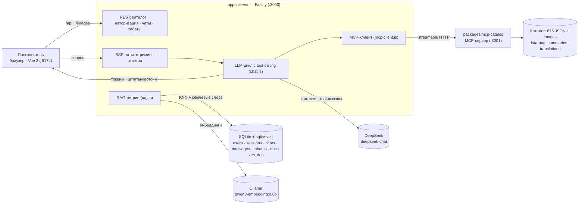

# architecture.md — архитектура gPower

Источник истины о **системе**. Монорепо на npm workspaces; границы между пакетами — часть контракта.

## Диаграмма



## Компоненты

| Компонент | Путь | Ответственность |
|---|---|---|
| Web | `apps/web` | Vue 3 SPA: каталог, вход, вкладки «Ассистент», «Табата» и «Помощь», FAQ, стриминг ответов, табата-плеер |
| API | `apps/server/src` | Fastify: REST каталога, авторизация, чаты, табаты, SSE, RAG-ретрив, LLM-цикл, MCP-клиент |
| Каталог-ядро | `packages/catalog-core` | Загрузка датасета, RU-словарь, фильтры, двуязычный поиск, чтение резюме |
| MCP-сервер | `packages/mcp-catalog` | Streamable HTTP MCP-сервер с инструментами каталога |
| Дополнения | `data-aug/summaries`, `data-aug/translations`, `data-aug/media` | 876 резюме RU/EN, 876 RU-переводов, 224 маппинга GIF (версионируются) |
| Датасет | `free-exercise-db` | Внешний клон (не изменяется) |
| Медиа-датасет | `cesar-exercises-dataset` | Внешний клон GIF-анимаций (не изменяется; медиа © Gym visual) |

Скрипты: `apps/server/scripts/build-index.js` (`npm run index`), `generate-summaries.js` (`npm run summaries`), `generate-translations.js` (`npm run translations`), `build-media-map.js` (`npm run media-map`); общие приёмы LLM-вызовов — `scripts/lib/llm.js`.

## Порты и процессы

| Процесс | Порт | Примечание |
|---|---|---|
| Web (Vite dev) | 5174 | проксирует `/api`, `/images` и `/gifs` на API |
| API (Fastify) | 3000 | `PORT` из `.env` |
| MCP-сервер | 3001 | `MCP_PORT`; API подключается по `MCP_URL` |

## Потоки

**Каталог.** Браузер → `GET /api/exercises` → `catalog-core.filterExercises` (структурные фильтры + поиск с ранжированием) → срез страницы → JSON. Картинки: `GET /images/*` → `@fastify/static` из `free-exercise-db/exercises`; GIF: `GET /gifs/*` → `@fastify/static` из `cesar-exercises-dataset/videos`. Обе статические ветки отдаются с `Cache-Control: public, max-age=31536000, immutable` (датасеты неизменяемы), поэтому автосмена фото каждые 1с идёт из кеша браузера; фронтенд дополнительно греет фото текущего/следующего упражнения.

**RAG-ретрив.** Вопрос → эмбеддинг через Ollama → KNN в `vec_docs` (sqlite-vec) + ключевой поиск `LIKE` по `docs.text` → объединение и ранжирование → топ-6 документов → в системный промпт.

**Чат с tool-calling.** История (≤10) + контекст + вопрос → LLM (стриминг). Если модель запрашивает инструмент — бэкенд вызывает MCP-инструмент, добавляет результат и повторяет (≤8 шагов). Если все шаги ушли на вызовы инструментов, добавляется финальная генерация без инструментов — ответ клиенту всегда содержит текст, а не остаётся пустым. Токены уходят клиенту по SSE санитизированными; найденные упражнения собираются в цитаты, созданные табаты — в событие `tabata` (в личных чатах). В авторизованных чатах к MCP-инструментам добавляется локальный `create_tabata` (`tabata.js`): он не часть MCP-сервера и выполняется с `user_id` сессии; в анонимном `/api/help` недоступен.

**Табаты.** Ручной конструктор во вкладке «Табата» → `POST/PUT /api/tabatas` → валидация лимитов и обогащение упражнений из `catalog-core` → строка в `tabatas`. Плеер строит фазы из `params`/`exercises` на клиенте (WebAudio-сигналы, Wake Lock); сохранённые табаты — per-user.

**Авторизация.** Регистрация/вход → серверная сессия в `sessions` → cookie `gp_session` (HttpOnly). Каждый защищённый эндпоинт читает cookie → `requireUser`. Анонимный `POST /api/help` в базу не пишет.

## Границы (не нарушать)

- `catalog-core` **не знает** про HTTP, базу и LLM — это чистая логика данных и поиска.
- `mcp-catalog` **не знает** про SQLite и чаты — только инструменты каталога.
- Только `apps/server` работает с SQLite, LLM и MCP-клиентом.
- Web обращается к серверу **только** через `/api`, `/images` и `/gifs`.

## Дерево репозитория

```
gPower/
├── apps/
│   ├── server/
│   │   ├── src/        # index, config, db, auth, rag, chat, tabata, mcp-client, routes*
│   │   └── scripts/    # build-index.js, generate-summaries.js, generate-translations.js, build-media-map.js
│   └── web/
│       └── src/        # main, router, api, auth-store, tabata-player, views/, components/, faq.js
├── packages/
│   ├── catalog-core/   # data, dictionary, search, catalog
│   └── mcp-catalog/    # server.js, catalog-service.js
├── data-aug/summaries/ # 876 RU/EN-резюме
├── data-aug/media/     # 224 маппинга GIF + overrides.json
├── data/               # SQLite + индекс (gitignored)
├── free-exercise-db/   # клон датасета (gitignored)
└── cesar-exercises-dataset/  # клон GIF-датасета (gitignored, медиа © Gym visual)
```

## Внешние зависимости и деградация

| Зависимость | Нужна для | Если недоступна |
|---|---|---|
| Ollama `qwen3-embedding:0.6b` | эмбеддинги RAG и построение индекса | ассистент отвечает без RAG-контекста; `npm run index` падает |
| DeepSeek API | ответы и генерация резюме | чат отдаёт понятную ошибку; `npm run summaries` падает |
| MCP-сервер | инструменты каталога | цикл работает без инструментов (не падает) |
